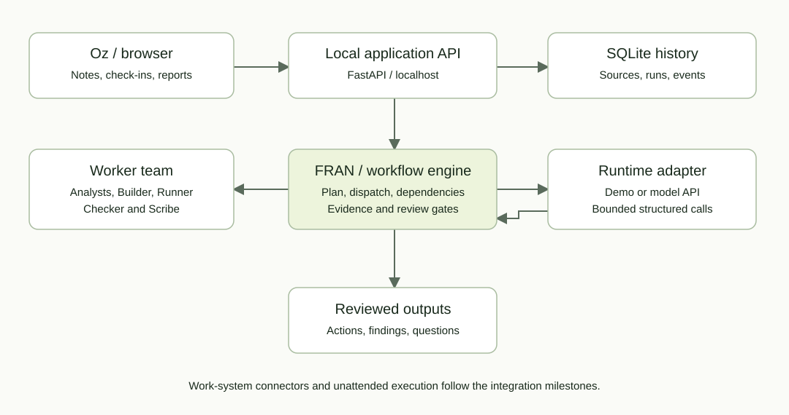

# Architecture

FRAN is the Project Manager: the queen bee coordinating outcomes and reporting
the project's direction. The Coordinator handles dispatch. Specialists and the
general Worker produce work; the Reviewer checks it; the Communications Agent
prepares the management-facing draft. These names are labels on reusable role
configurations.

| Layer | Initial implementation |
|---|---|
| Interface | Browser dashboard served locally; no separate desktop executable required. |
| Application API | FastAPI, including runs, history, configuration, and report export. |
| Workflow engine | Capability-based steps with dependencies and separated reviews. |
| Agent team | One Agent class, role configurations, registry, and runtime injection. |
| Model adapter | Deterministic demo or OpenAI Responses with structured output. |
| State | SQLite source records, run status, and append-only assignment/result events. |
| Work integrations | Planned source and action adapters for the approved work systems. |
| Documentation | Sphinx and Markdown/MyST, with versioned templates and Git history. |

## Process boundaries

GitHub is the development workspace: code, documentation, issues, and pull
requests. Franark is the operational workspace: run notes, agent messages,
artifacts, and questions. Operational data stays in configured local storage,
outside Git. Live model mode sends the selected source packet to its API provider.

An agent is a configured runtime instance, not a separate ChatGPT user account.
Agents exchange structured outputs through the engine. A future connector may
let a ChatGPT conversation submit jobs to Franark, but it is a distinct integration
from the model API. The local app already provides the place to inspect work.

## Extensibility

Add a role definition, register an instance, and add or insert a step requesting
its capability. Core routing does not contain a separate branch for every job
title. Display labels, project membership, model choice, and tools are separate
configuration concerns.

The tool gate intersects role, instance, and project grants. Connectors must
also constrain the specific resources and actions. The pilot grants no external
business tools. It prepares proposed checks, analysis, and drafts from submitted
notes. Work-tool execution will require scoped adapters and action records.

## Priorities and evidence

FRAN applies owner-approved priority criteria to referenced facts. A policy must
define rules, thresholds, and tie-breakers. Arithmetic belongs in deterministic
code. Recommendations identify their evidence and assumptions. With no policy
supplied, this pilot leaves the order unranked and collects the criteria needed.

The shared task packet has source evidence. Each result refers to known evidence
IDs. That structural check does not establish semantic support for a claim; the
Reviewer also checks the substance and source applicability.

## Execution and persistence

The pilot uses one worker thread and admits up to three queued/running runs.
Each completed step is saved to SQLite. A restart marks unfinished work as
interrupted rather than silently replaying API calls. Durable job resumption,
bounded automatic rework, scheduling, and hard spending accounting are later
milestones.

For an always-on installation, run the same container on an approved work
computer or server. A sleeping or powered-off personal computer cannot continue
local work.
