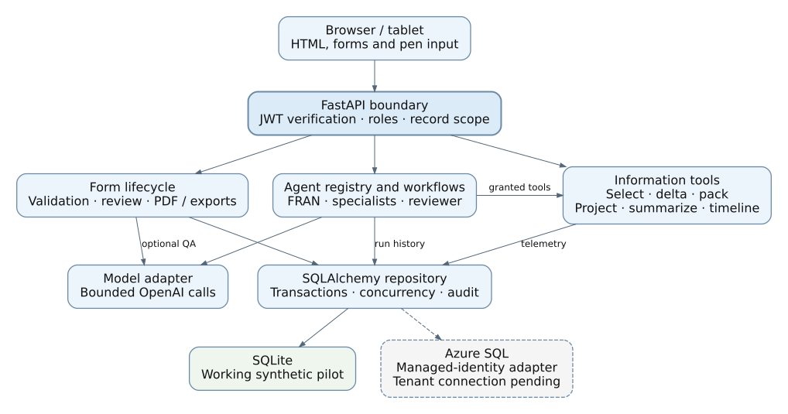
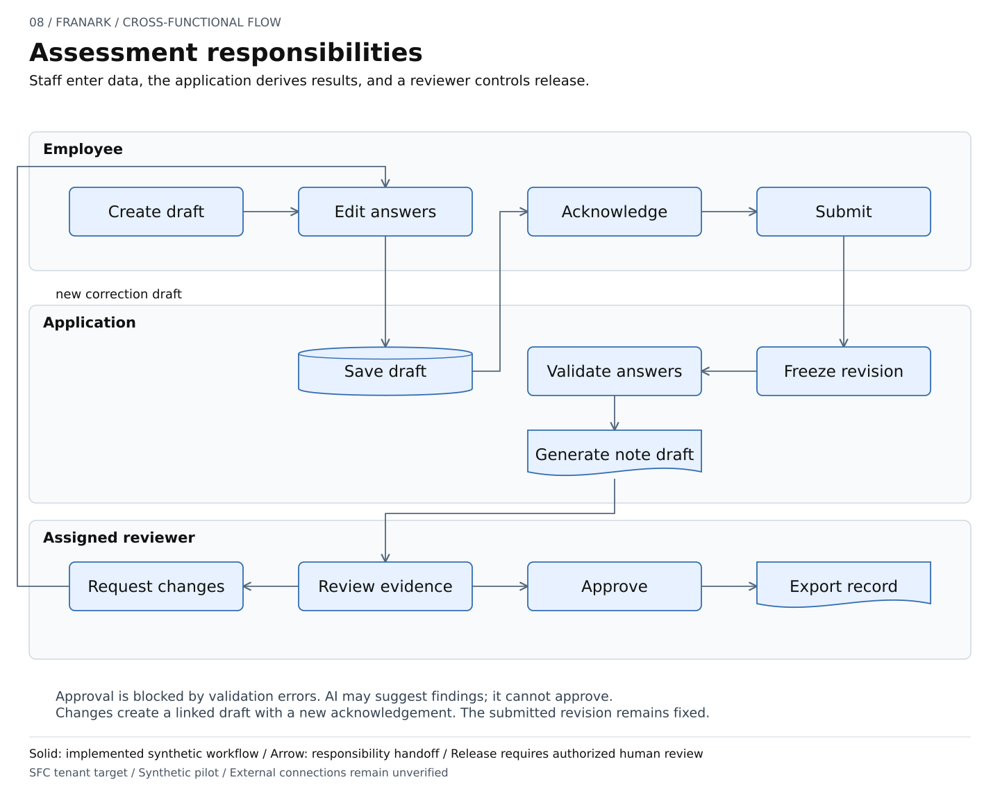
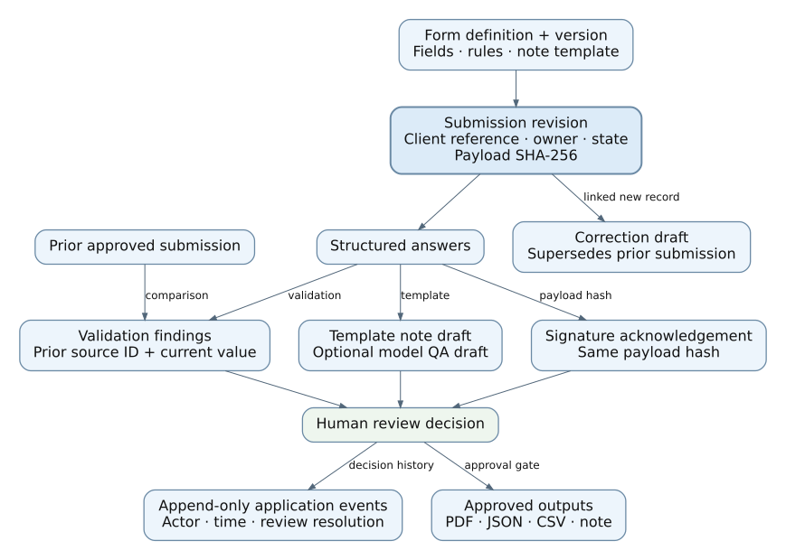

# System diagrams

The diagrams use black text and light surfaces. Solid components show the
implemented pilot; dashed components identify optional or external connections
that require configuration or verification. The same views are available in the
application at `/architecture`, with full-size SVGs.

## System context

Employees and reviewers use Franark; identity, models and destination systems
remain explicit surrounding services.

## Software stack

The portal, agent workflows and six information tools share the API boundary and
relational repository. SQLite is active locally; Azure SQL has a configured
adapter whose live tenant connection still needs verification.

## Assessment and review flow

Submitted answers and acknowledgements stay fixed. Corrections create a new
draft, and AI suggestions do not release exports.

## Record links and provenance

Each form definition, answer set, signature, note, finding and review decision
remains traceable to the appropriate submission revision.

Editable Graphviz source is maintained in `docs/diagrams`. Regenerate SVGs with
`python tools/render_diagrams.py`. Export the four-page PDF with
`python tools/export_diagrams.py --output PATH.pdf`; Graphviz is required for
rendering/export and is not required to run the application.
