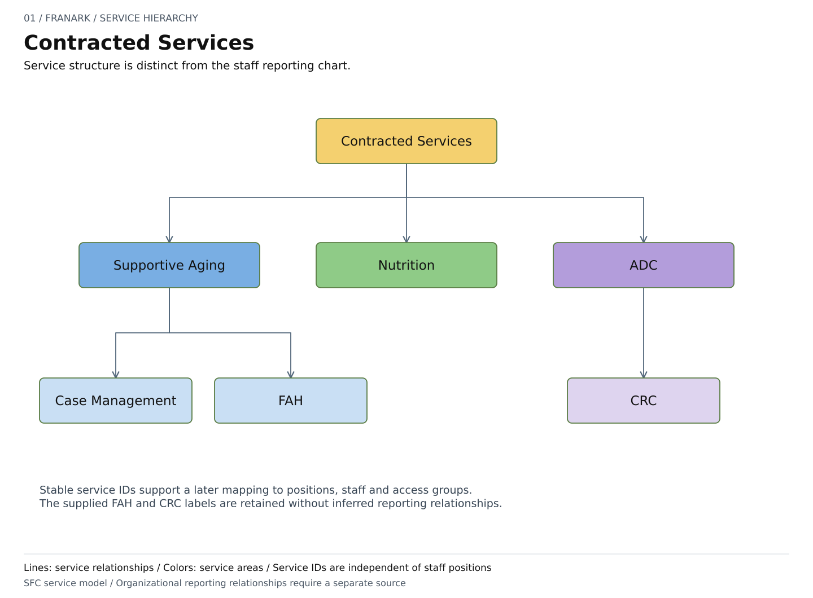
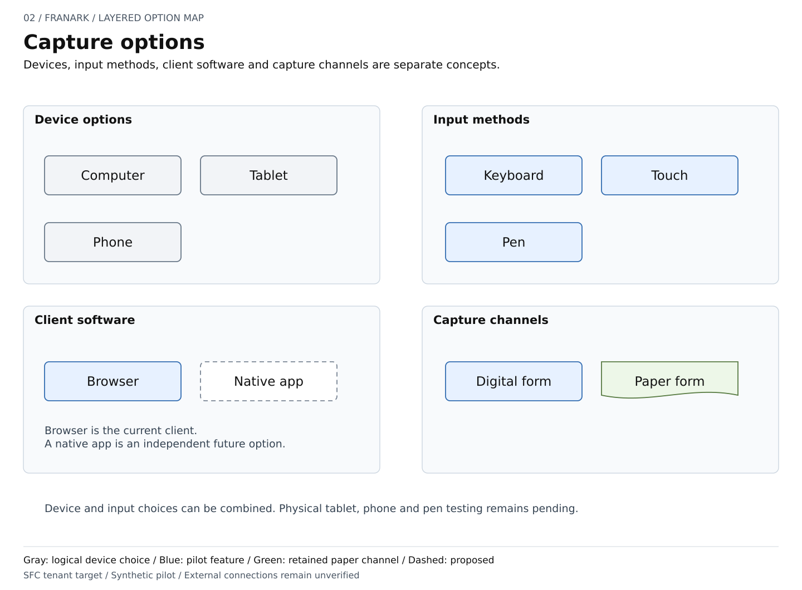
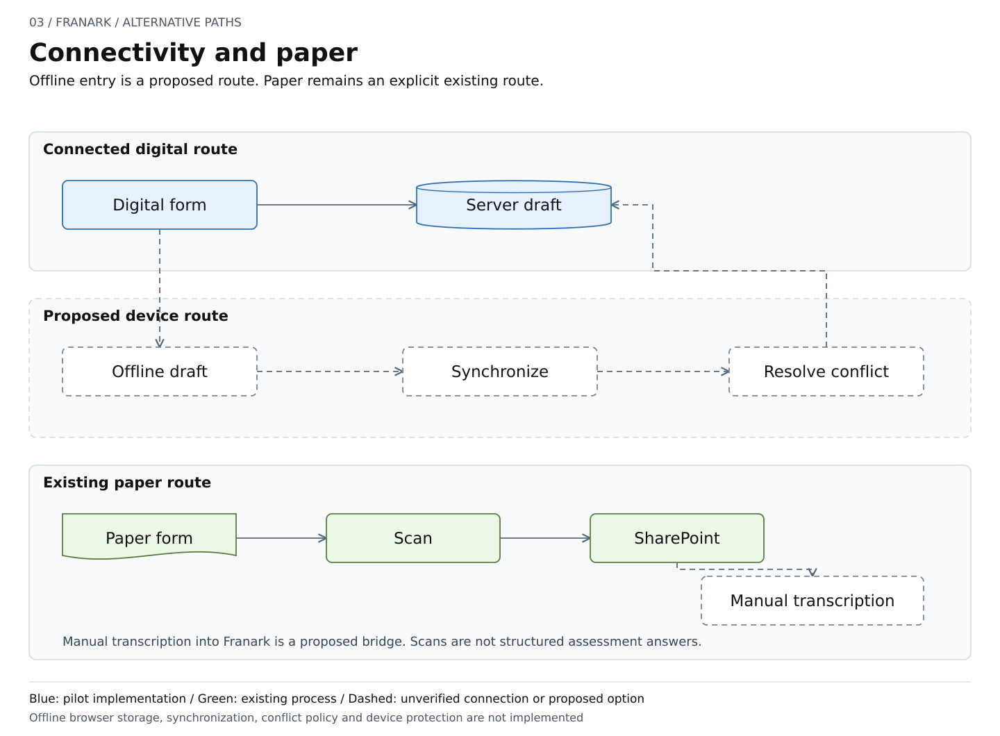
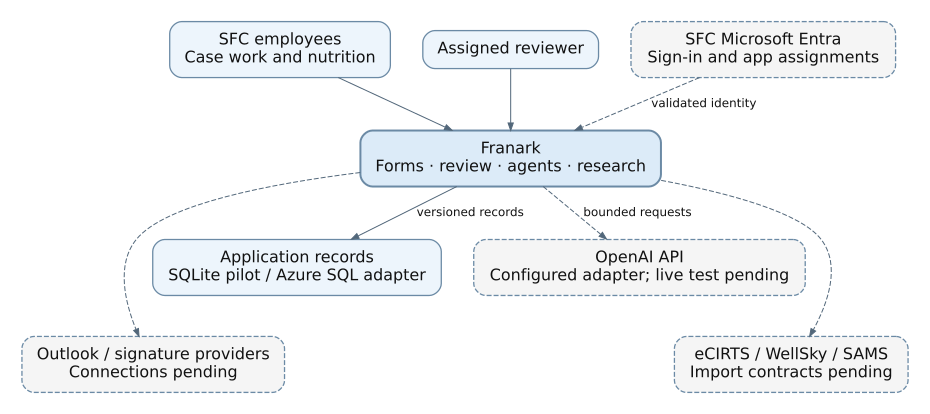
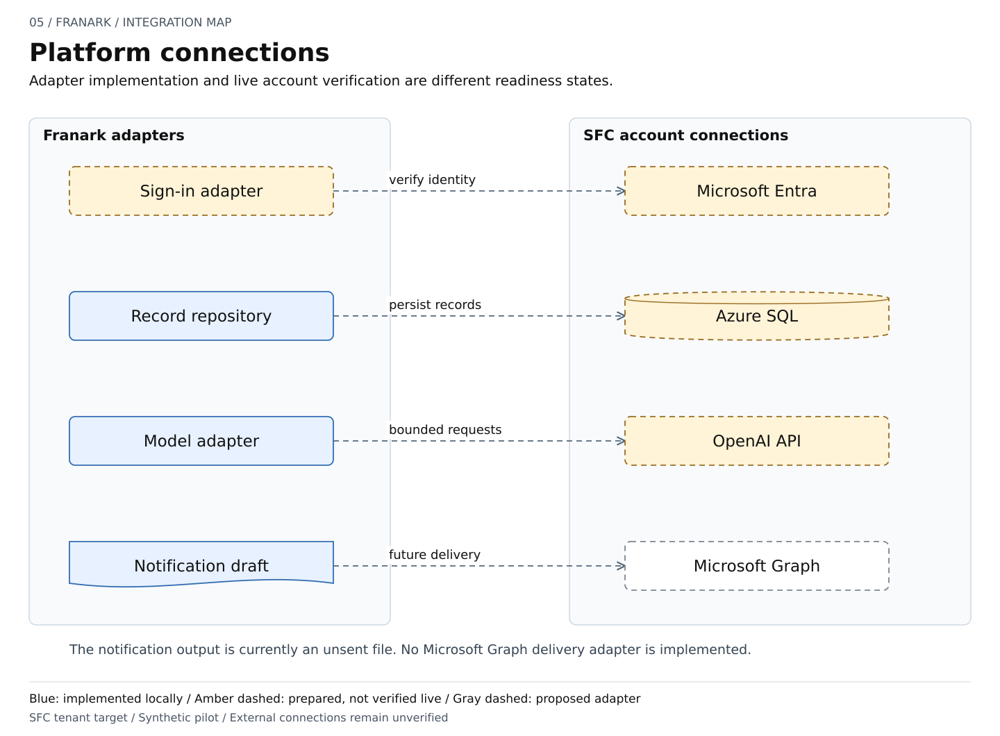
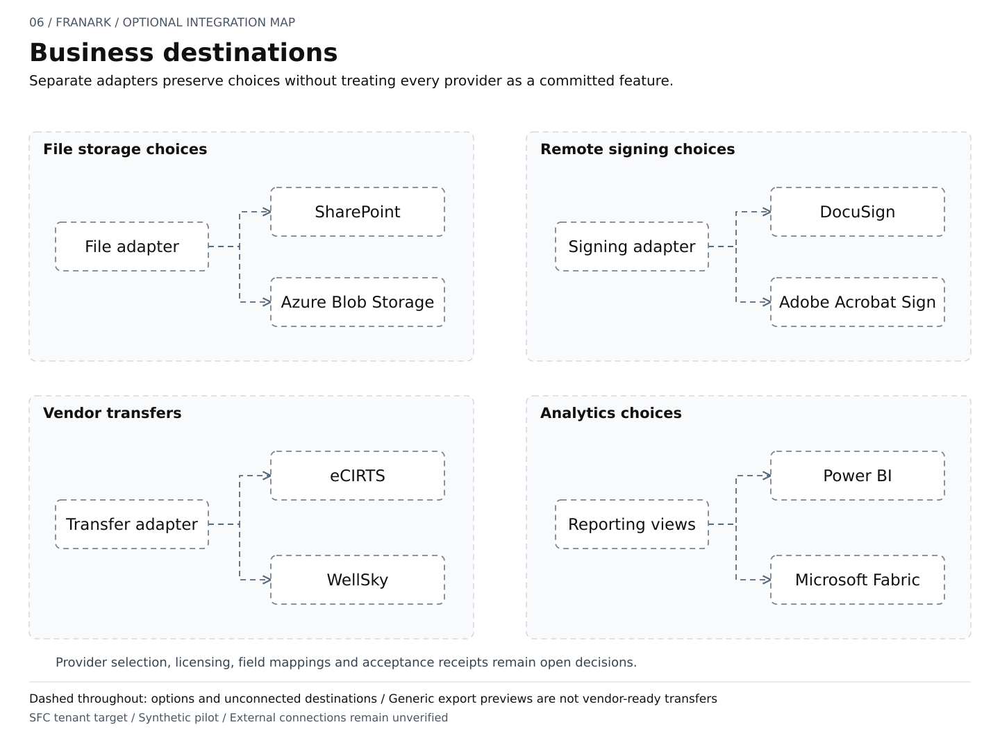
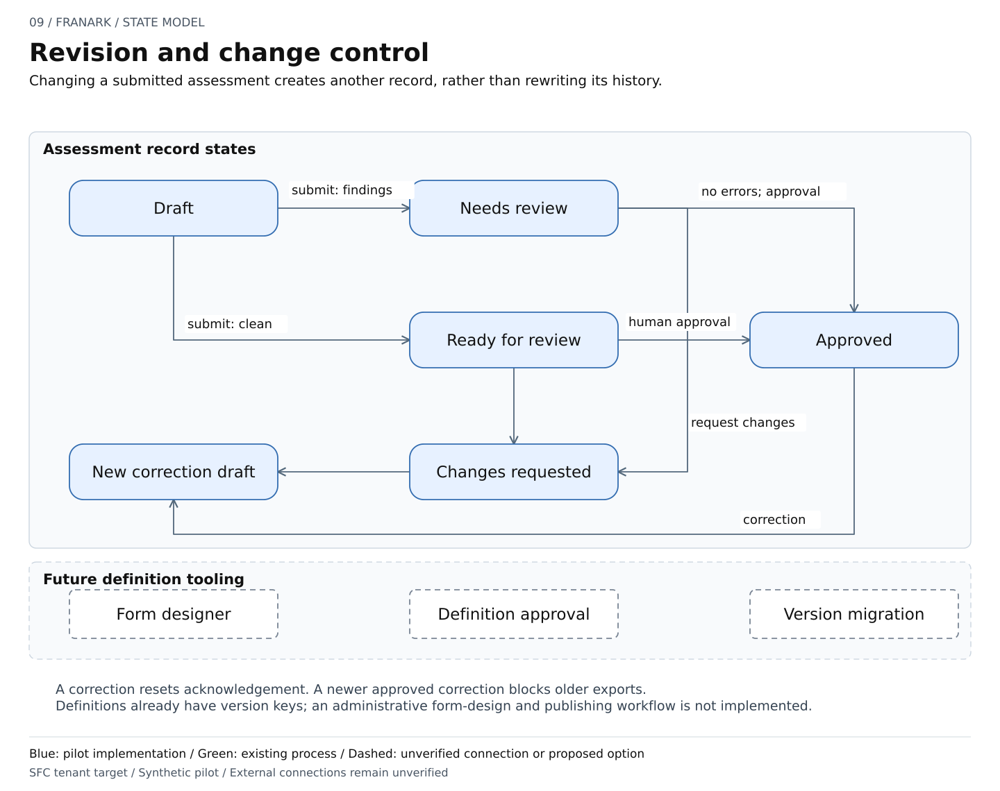
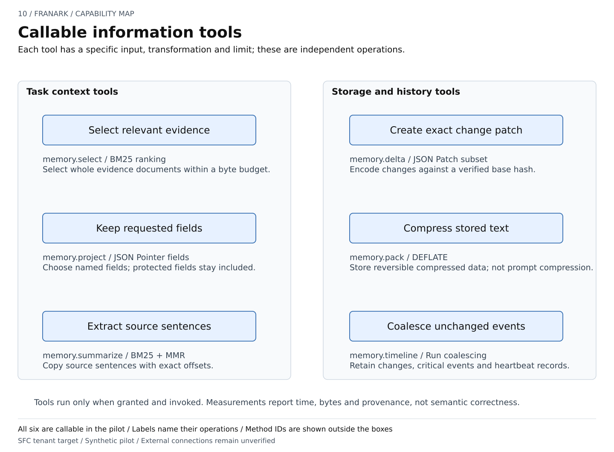
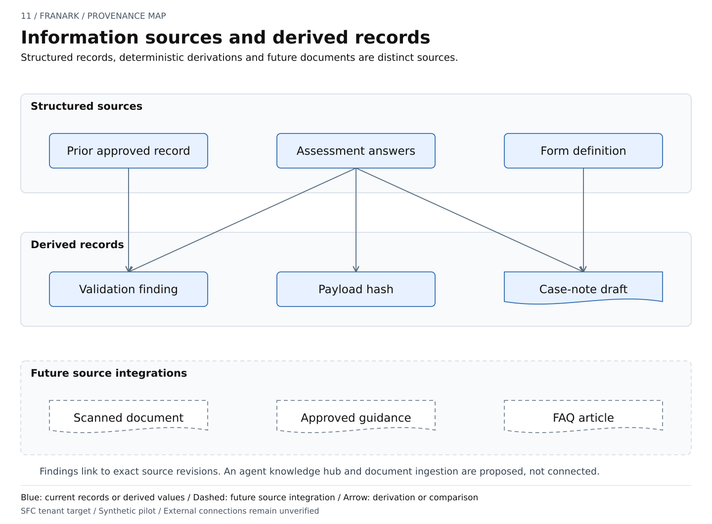

# System diagrams

Each view answers one question. One node represents one actor, tool, action,
state, source or entity. Groups classify related concepts without combining their
labels. The application at `/architecture` displays one selected view and offers
SVG, native Excalidraw and Mermaid downloads.

| View | Question | Notation |
|---|---|---|
| Contracted Services | How are the supplied service areas related? | Service hierarchy |
| Capture options | Which device, input method, client and channel are separate choices? | Grouped option map |
| Connectivity and paper | How do connected entry, proposed offline entry and existing paper differ? | Alternative paths |
| People and application surfaces | Who uses each application surface? | System context |
| Platform connections | Which adapters exist and which accounts still need verification? | Integration map |
| Business destinations | Which storage, signing, vendor and analytics choices remain optional? | Grouped integration map |
| Software stack | Which language, framework, control, service and database is responsible for each layer? | Layered architecture |
| Assessment responsibilities | Which actions belong to staff, the application and a reviewer? | Cross-functional flow |
| Revision and change control | Which changes alter state and which create another record? | State model |
| Callable information tools | What does each of the six independent methods do? | Capability map |
| Information sources and derived records | Which inputs produce findings, notes and hashes? | Provenance map |
| Relational data model | Which tables and foreign keys actually exist? | Entity relationships |

## Readiness is separate from grouping

- Blue, solid: implemented synthetic pilot functionality.
- Green, solid: an existing service structure or external/manual process.
- Gray, solid: a logical concept, such as a device or actor; no device compatibility claim.
- Amber, dashed: a prepared connection requiring live configuration and verification.
- Gray, dashed: a proposed option or unimplemented adapter.

The physical device, capture channel, interaction method and client software are
independent dimensions. A tablet runs software; a browser is client software;
a pen is an input method; paper is a capture channel. Existing paper work remains
visible. A connected server draft already works; offline device storage,
synchronization and conflict handling remain proposed. Browser refresh alone is
not an offline-saving mechanism.

The business destinations show alternatives, not a commitment to implement every
provider. A live external service may exist while its Franark adapter is still
proposed. No diagram converts an optional node into a delivered integration.

## Lifecycle and change control

The cross-functional flow includes creation, edits, draft saving, acknowledgement,
submission, validation, note creation, review, approval, export and requested
changes. A submitted revision remains fixed. Corrections create linked new drafts
and require new acknowledgement. A newer approved correction blocks exports from
the superseded record. Validation errors block approval.

Form definitions already have version keys. A form designer, administrative
definition approval and automated version migration remain separate future tools.
The pilot does not claim to provide a visual form builder or automated publishing.

## Callable tools

| Diagram label | Callable method | Meaning |
|---|---|---|
| Select relevant evidence | `memory.select` | Rank supplied documents with BM25 and select whole documents under a byte budget. |
| Keep requested fields | `memory.project` | Select explicitly named JSON fields, including protected fields. The verb means field projection. |
| Extract source sentences | `memory.summarize` | Select source sentences with BM25/MMR and retain exact source offsets. |
| Create exact change patch | `memory.delta` | Describe changes against an exact, hash-verified base using the supported JSON Patch subset. |
| Compress stored text | `memory.pack` | Reversible DEFLATE/base64 storage encoding; no LLM prompt compression claim. |
| Coalesce unchanged events | `memory.timeline` | Combine identical consecutive snapshots while retaining changes and required events. |

Research definitions, equations, limits and citations remain in
[Information methods](../research/methods.md). Tools are invoked only when a
workflow grants and calls them; displaying them does not imply automatic use in
every assessment.

## Editing and regeneration

The maintained model is `docs/diagrams/atlas.json`. Semantic IDs, categories,
readiness, node coordinates and connections are separate fields. An entity box
may list its own keys; it still represents one table. The ER view reflects the
actual SQLAlchemy schema rather than inventing separate answer/signature tables.

The service IDs can later be linked to an organizational model. The supplied
Contracted Services relationships are retained, with no provisional edge note.
Caregiving Institute is not added. Service relationships do not imply staff
reporting lines or application access grants.

I regenerate the application previews and editor sources with:

```powershell
python tools/render_diagrams.py
```

I check that committed assets match their source with:

```powershell
python tools/render_diagrams.py --check
```

I export the vector PDF, a combined Excalidraw board and individual source files
with:

```powershell
python tools/render_diagrams.py --board output/diagrams/Franark_SFC_Architecture.excalidraw
python tools/export_diagrams.py --output output/pdf/Franark_SFC_System_Atlas.pdf --bundle output/diagrams/Franark_SFC_Diagram_Sources.zip
```

Each Excalidraw concept has native editable shapes and bound text. Connectors are
bound to their source and target nodes. The combined board places each view in
its own frame. No view is a flattened screenshot embedded in an editor file.
Mermaid sources preserve the appropriate notation; their automatic layout can
differ from the positioned SVG and Excalidraw view. Changes made in an external
editor need to be reconciled into the maintained model before regeneration.

ReportLab is already an application dependency. Rendering no longer requires
Graphviz or an external diagram service. The application serves packaged static
assets and sends no records to an editor.

## View previews

### Contracted Services

Service structure is distinct from the staff reporting chart.



### Capture options

Devices, input methods, client software and capture channels are separate concepts.



### Connectivity and paper

Offline entry is a proposed route. Paper remains an explicit existing route.



### People and application surfaces

Each surface has a distinct purpose. A knowledge hub remains a proposed surface.



### Platform connections

Adapter implementation and live account verification are different readiness states.



### Business destinations

Separate adapters preserve choices without treating every provider as a committed feature.



### Software stack

Languages, frameworks, access controls, services and databases have separate nodes.


### Assessment responsibilities

Staff enter data, the application derives results, and a reviewer controls release.


### Revision and change control

Changing a submitted assessment creates another record, rather than rewriting its history.



### Callable information tools

Each tool has a specific input, transformation and limit; these are independent operations.



### Information sources and derived records

Structured records, deterministic derivations and future documents are distinct sources.



### Relational data model

Each entity is an actual pilot table. Answers and signatures are fields, not separate tables.


